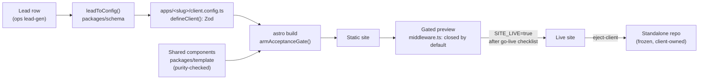

# Architecture

How a lead becomes a gated preview, and which code enforces each step. Every
path below is real; follow it to check the claim.

## The contract

A client site is data, not code. `ClientConfig` is a Zod schema in
`packages/schema/src/index.ts`; `defineClient()` validates a config against it
and throws on anything malformed. Each app's single editable file,
`apps/_template/client.config.ts` (copied per client), calls `defineClient()`,
so the build itself is the validator: an invalid config cannot produce a site.

The contract is render-agnostic. The engine that emits configs (lead sourcing
and the AI writer) lives in the `hirobius/ops` repo; this repo owns the
contract and one render target (Astro).

## Enforcing modules

| Concern | Enforced by | Tested in |
| --- | --- | --- |
| Config shape | `defineClient()` in `packages/schema/src/index.ts` | `packages/schema/src/index.test.ts` |
| Lead → config, no invented facts | `packages/schema/src/lead-to-config.ts` (stubs + TODO list, never fabricates) | `packages/schema/src/lead-to-config.test.ts` |
| Go-live readiness (placeholders, claims, contrast) | `armAcceptanceGate()` in `packages/template/src/build-gate.ts`, called from `apps/_template/astro.config.ts` | `packages/template/src/acceptance.test.ts`, `packages/template/src/build-gate.test.ts`, `packages/template/src/astro-config-gate.test.ts` |
| Shared components stay schema-driven and token-only | `packages/template/src/purity.ts` (no literal colours, fonts, scripts or external URLs) | `packages/template/src/purity.test.ts` |
| Previews are closed by default | `apps/_template/middleware.ts` (Vercel Routing Middleware: key link, sign-in, Basic auth; open only with `SITE_LIVE=true`) | `apps/_template/tests/middleware.test.ts`, `packages/template/src/middleware-gate.test.ts` (every app's copy matches) |
| Gated preview deploys | `scripts/deploy-preview.ts` (preview-only, never `--prod`), proven by `scripts/verify-live.ts` | `scripts/deploy-preview.test.ts`, `scripts/verify-live.test.ts` |
| Going live needs a recorded checklist | `scripts/go-live.ts` | `scripts/go-live.test.ts` |
| Handoff = a frozen standalone repo | `scripts/eject-client.ts` (inlines workspace packages, pins versions) | `scripts/tooling.test.ts` |
| Fleet drift | `.github/workflows/visual.yml` (visual regression), `.github/workflows/lighthouse.yml` (perf and a11y budgets) | CI |

## Why it is shaped this way

- **One file per client.** Agents and people edit only the config and photos;
  anything the schema can't express is a different (custom) engagement, not an
  escape hatch. See `CLAUDE.md`.
- **The build is the gate.** Validation runs where the site is made, so there
  is no "forgot to run the checker" path.
- **Closed by default.** A preview that leaks to search or to the wrong person
  is worse than one that 401s, so the middleware fails closed.
- **Eject to freeze.** A shared-component change restyles every workspace
  site; handed-off sites are ejected so they never change without a paid,
  deliberate update.

Operator detail lives in `docs/PIPELINE-RUNBOOK.md` and `docs/GO-LIVE.md`.
