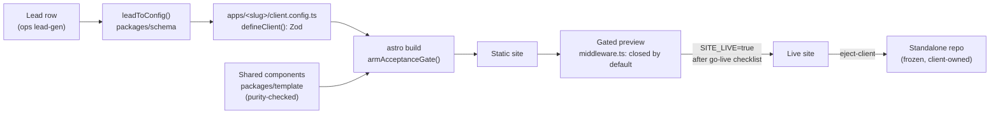

# Architecture

This page follows a lead from the moment it arrives to the point where a
client owns their site, and names the code that enforces each step. All the
paths are real, so you can open any of them and check.

## The contract

Every client site comes from a config object. `ClientConfig` is a Zod schema
in `packages/schema/src/index.ts`, and `defineClient()` validates a config
against it, throwing if anything is off. Each app has exactly one file meant
for editing, `client.config.ts` (the template copy is
`apps/_template/client.config.ts`), and that file calls `defineClient()`.
Since the build imports it, a bad config stops the build before a site exists.

Nothing in the config is tied to Astro. Astro is just the renderer used
today. Finding leads and writing copy happen in the `hirobius/ops` repo,
which produces configs in this format.

## Enforcing modules

| Concern | Enforced by | Tested in |
| --- | --- | --- |
| Config shape | `defineClient()` in `packages/schema/src/index.ts` | `packages/schema/src/index.test.ts` |
| Lead → config, no invented facts | `packages/schema/src/lead-to-config.ts` (stubs + TODO list, never fabricates) | `packages/schema/src/lead-to-config.test.ts` |
| Go-live readiness (placeholders, claims, contrast) | `armAcceptanceGate()` in `packages/template/src/build-gate.ts`, called from `apps/_template/astro.config.ts` | `packages/template/src/acceptance.test.ts`, `packages/template/src/build-gate.test.ts`, `packages/template/src/astro-config-gate.test.ts` |
| Shared components stay schema-driven and token-only | `packages/template/src/purity.ts` (no literal colours, fonts, scripts or external URLs) | `packages/template/src/purity.test.ts` |
| Previews are closed by default | `apps/_template/middleware.ts` (Vercel Routing Middleware: key link, sign-in, Basic auth; open only with `SITE_LIVE=true`) | `apps/_template/tests/middleware.test.ts`, `packages/template/src/middleware-gate.test.ts` (every app's copy matches) |
| Gated preview deploys | `scripts/deploy-preview.ts` (preview-only, never `--prod`), proven by `scripts/verify-live.ts` | `scripts/deploy-preview.test.ts`, `scripts/verify-live.test.ts` |
| Going live needs a recorded checklist | `scripts/go-live.ts` | `scripts/go-live.test.ts` |
| Handoff = a frozen standalone repo | `scripts/eject-client.ts` (inlines workspace packages, pins versions) | `scripts/tooling.test.ts` |
| Fleet drift | `.github/workflows/visual.yml` (visual regression), `.github/workflows/lighthouse.yml` (perf and a11y budgets) | CI |

## Why it works this way

- **One file per client.** People and agents only touch the config and the
  photos. If a client wants something the schema can't describe, that's
  quoted as custom work. Nobody bends a shared component to fit. The rules are
  in `CLAUDE.md`.
- **Checks run inside the build.** There's no separate checker to forget to
  run. If the config is wrong, the site doesn't build.
- **Previews start locked.** A preview that shows up in search results, or in
  front of the wrong person, does more damage than one that asks for a
  password. So the gate fails closed.
- **Handed-off sites are frozen.** A change to a shared component restyles
  every site still in this repo. Ejecting a client's site means it only
  changes when they pay for an update.

The step-by-step operator guides are `docs/PIPELINE-RUNBOOK.md` and
`docs/GO-LIVE.md`.
